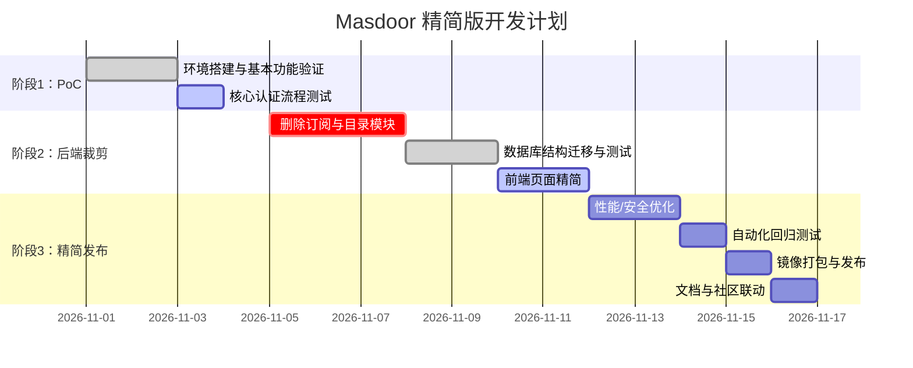

# 执行摘要

Masdoor 本身是一套功能全面的企业级 IAM 系统。为了适配个人/家庭自托管场景，我们仅保留 **OIDC/OAuth2**、**用户管理** 和**主题自定义** 核心功能，移除付费订阅、AI Agent 网关、企业目录协议等冗余模块。计划分三阶段进行：第一阶段实现最小可用身份认证服务；第二阶段裁剪后端与数据库；第三阶段精简发布并准备回归测试和维护流程。裁剪后系统仍支持完整自定义登录页（主题配置、CSS/HTML 槽位等）。下表列出主要的保留/移除模块，后续将详细说明各阶段任务、数据库迁移方案、安全保障、测试矩阵、资源优化和发布策略等，帮助工程团队直接采纳执行。

| 模块/路径                      | 操作 | 说明                                                                                                                                                                                           |
| -------------------------- | -- | -------------------------------------------------------------------------------------------------------------------------------------------------------------------------------------------- |
| **保留:** OAuth/OIDC 核心      | 保留 | `controllers/authorize.go`、`controllers/token.go` 等授权流程和令牌签发逻辑；OIDC/PKCE、刷新令牌、JWT 签发、撤销等。                                                                                                    |
| **保留:** 用户与会话管理            | 保留 | 用户注册/登录/登出、密码重置、邮箱/短信验证码、多因素登录（TOTP/Passkeys/FaceID）功能。对应控制器如 `controllers/user.go`、`controllers/login.go`、`controllers/logout.go`、`controllers/password.go` 等。                              |
| **保留:** 应用与客户端配置           | 保留 | OAuth 客户端（应用）管理相关代码（如 `controllers/application.go`），管理 ClientID/Secret、回调 URL、权限等；预留主题配置字段供自定义登录页使用。                                                                                         |
| **保留:** 基本授权策略             | 保留 | RBAC/权限管理核心（Casbin 模型）逻辑；`controllers/role_policy.go` 等。尽管仅单组织使用，也应保留最低级的角色/权限控制和审计日志。                                                                                                       |
| **保留:** 自定义登录页主题系统         | 保留 | 主题相关字段和渲染逻辑：Application 模型的主题字段（`FormCss`、`FormOffset`、`HeaderHtml`、`SigninHtml` 等）及前端 UI 定制器。前端 `web/src/components/auth/AuthLayout.tsx` 与 `LoginPage.tsx` 相关实现（布局插槽、CSS 注入）必须保留并简化界面。      |
| **保留:** 静态资源与基本页面          | 保留 | 登录、注册、密码重置等页面模板和样式；多语言（可选降低优先级）、基础运维功能（备份、日志审计、配置管理）等。                                                                                                                                       |
| **移除:** 商业订阅/计费模块          | 移除 | `pp/` 目录及相关 `object` 中的 Product、Order、Pricing、Plan、Subscription 等数据模型；前端中的商品/订单管理页面。替代方案：无需订单付款流程，直接跳过购买环节。                                                                                  |
| **移除:** AI Agent (MCP/A2A) | 移除 | `mcp/`、`mcpself/` 目录及相关后端逻辑；Agent 管理界面、授权策略、Agent-to-Agent 通信等全部删除。                                                                                                                          |
| **移除:** 企业目录协议             | 移除 | LDAP (`ldap/`)、RADIUS (`radius/`)、Kerberos、SCIM (`scim/`)、旧式 CAS/SAML 等。如无联动企业系统需求，删除或禁用 `controllers/ldap.go` 等同步服务；删除 `object/Syncer`, `controllers/scim.go` 等。可选：若暂时保留多租户概念，可隐藏界面不彻底删除模型。 |
| **移除:** 第三方登录/存储适配器        | 精简 | 保留极少数社交登录、邮件/SMS 服务，如 GitHub/Google OIDC；删除不使用的 Provider 适配器。后端接口`idp/`（自定义身份提供者模板）可精简；前端删除“身份提供商模板”相关模块。                                                                                    |
| **移除:** Marketplace 与模板市场  | 移除 | 前端 `web/src/pages/Marketplace*`、后端无关逻辑；CAS/SAML 模板页面；以及“市场”菜单和链接。                                                                                                                            |
| **移除:** 非核心运维              | 移除 | `scan/`（安全扫描）、`upgrade/`（升级工具）等，因个人版无升级兼容需求；`proxy/`（OIDC 代理）功能可删除；`xlsx/`（Excel 导入导出）可移除。                                                                                                   |

## 分阶段实施计划

将项目划分为三个阶段：**PoC / 最小可用产品 (MVP)**、**后端裁剪**、**精简发布**。每阶段明确任务、产出、时间预估、回滚策略和验收标准如下：

| 阶段                | 任务描述                                                                                                                                                                                                                                                                                                                                                                                                                                                                                                                                                                                                                                                                                      | 产出/里程碑                                                                         | 预计时间 | 回滚策略           | 验收标准                                                                                                                              |
| ----------------- | ----------------------------------------------------------------------------------------------------------------------------------------------------------------------------------------------------------------------------------------------------------------------------------------------------------------------------------------------------------------------------------------------------------------------------------------------------------------------------------------------------------------------------------------------------------------------------------------------------------------------------------------------------------------------------------------- | ------------------------------------------------------------------------------ | ---- | -------------- | --------------------------------------------------------------------------------------------------------------------------------- |
| **阶段1：MVP (PoC)** | - 克隆 Masdoor 仓库，配置 SQLite 数据源（`driverName=sqlite3`）快速启动实例。 <br />- 关闭配置文件中不必要的功能（如 `initData`, `localLogin`, `themeUpload`）。 <br />- 禁用后台Scheduler/Redis（仅单实例）。 <br />- 通过管理界面添加测试应用和用户，确保 OAuth2/OIDC 登录正常。 <br />- 测试登录流程：用户名/密码、邮箱验证码、WebAuthn、Passkey、多因子等是否工作。 <br />- 检查默认主题配置（颜色、Logo）能生效。                                                                                                                                                                                                                                                                                                                                                                                         | - 运行 Masdoor 基本系统，支持用户注册/登录和 OAuth2 授权。 <br />- 登录页和控制台无报错，能正常访问。              | 2 天  | 还原到原始仓库 + 最小配置 | - OAuth2/OIDC 流程无误，用户可以获取有效 JWT/ID Token。 <br />- 登录页能显示主题元素，如 Logo 和自定义颜色（默认值）。                                                  |
| **阶段2：后端裁剪**      | - **删除无用代码：** 按表格逐项移除（或注释）不需要的包和文件。<br />  • 删除 `pp/`、`mcp/`、`mcpself/`、`ldap/`、`radius/`、`scim/` 等目录。<br />  • 对应 `object/*.go` 中删除相关模型（Product、Order、Pricing、Plan、Subscription 等），并备份原始表结构。<br />  • 清理控制器中相应路由 (`routers/*.go`) 和服务调用。<br />- **数据库变更：** 创建迁移脚本，删除相关表和字段。<br />  • 修改 `application` 表删除不再使用字段，如商业化相关列，仅保留主题相关列。<br />  • 如计划简化组织，可考虑保留单个默认组织（但不必改动字段）。<br />- **依赖与配置：** 在 `main.go` 或配置文件中移除启动无关服务（LDAP Server、RADIUS Server 等）；<br />  • 更新依赖管理（`go.mod` 删除对应包）；<br />  • 删除 `web-old/` 前端遗留代码目录。<br />- **前端精简：** 在 `web/` 中移除 Marketplace、集成模板和订阅相关页面、菜单项。保留“应用设置 → UI 定制”选项卡并适当简化。隐藏 LDAP/RADIUS/SCIM 开关界面。<br />- **中期测试：** 每删一项功能执行回归测试，保证 OAuth/登录流程、用户管理不受影响。 | - 删除冗余模块后的可编译版本；<br />- 数据库结构更新完成（请迁移脚本运行无误）；<br />- 管理后台界面仅显示所需项（应用设置中有主题配置）。 | 5 天  | 随时退回对应提交       | - 无编译错误；<br />- 已部署版本在 SQLite 环境下能正常工作；<br />- **核心功能测试通过**：OAuth登录、注册、令牌、会话、MFA、忘记密码等均正常；<br />- 被移除功能（订阅/LDAP等）对应页面/API返回空或404。 |
| **阶段3：精简发布**      | - **优化与清理：** <br />  • 审查并删除多余的路由定义与资源文件。<br />  • 减少本地缓存/Pool（如删除 Redis 配置）、关闭不必要启动项。<br />  • 优化前端静态资源：精简打包配置，删除未使用组件。<br />- **安全与审核：** <br />  • 确保 CSRF、PKCE、nonce 和 OAuth2 逻辑没有被误删（参见）。<br />  • 保留 Masdoor 对自定义 HTML/CSS 的校验逻辑（见下文安全章节），避免 XSS 漏洞。<br />- **文档与迁移：** <br />  • 更新部署文档和配置示例（Docker、Helm可参考 Masdoor 原有文档）。<br />  • 撰写升级指南：说明从上游 Masdoor 合并更新流程（使用 rebase/merge）。<br />- **回归测试与发布：** <br />  • 完善自动化测试：针对已移除模块的 API （如订阅回调）验证行为（应报错或无操作）。<br />  • 生成 release 版本（二进制和 Docker 镜像）。<br />  • 迭代性能测试：记录优化前后的内存、镜像大小。                                                                                                                                                   | - 精简后端镜像发布版；<br />- 完整测试文档与升级说明；<br />- 可在 256MB 内存的环境中稳定运行。                   | 3 天  | 发布撤销新版本回滚旧版    | - **安全测试通过**：CSRF/PKCE 无缺失，无法通过自定义主题字段注入恶意脚本；<br />- **性能测试**：在预估内存下能启动并支持并发登录（见资源一节估算）；<br />- **回归测试无误**：所有关键测试（见下文测试矩阵）通过。     |

以上时间为粗略预估，总计划约10天左右（单人开发），可视资源情况并行或延长。每阶段建议使用版本控制（例如 Git 分支），便于出现问题时快速回退至上一个稳定提交。验收标准侧重于核心功能可用性和安全完整性。

## 数据库迁移方案

在删除订阅和目录相关表时，应编写迁移脚本（可用 [XORM](http://xorm.io) 或手写 SQL）支持无缝升级与回滚。主要变更包括：

- **删除表：** `Product`、`Order`、`Pricing`、`Plan`、`Subscription`、`Coupon` 等表（表名可根据 `object` 定义核对）。相应的外键也可一并删除。
- **修改字段：**
  - `Application` 表中删除如 `PricingName`、`Price` 等计费字段，仅保留用于登录页主题的字段（如 `FormCss` 等）。
  - 若不保留多组织，`User`/`Application` 表中的 `org` 字段可保留但默认值固定，不必删除；若要彻底移除组织概念，可将该字段变为无效并删除对应的外键和管理界面。
  - `User` 表：可保留基础字段，删除与订阅/payment 相关的字段（如有）。
- **新增表/字段：** 如需扩展 Application 的主题配置，可以添加 JSON 字段（或多列）存储主题设置，例如：

```sql
ALTER TABLE Application ADD COLUMN ThemeConfig JSON;
```

该字段可统一存储标题、配色、背景图、HTML 插槽等配置，便于一次性读写。若数据库不支持 JSON，可分解为多列。

- **回滚策略：** 备份原始数据库后执行迁移。如发现问题，可用备份恢复。设计时务必保证 `ALTER TABLE` 操作前备份数据，必要时先在次级环境验证脚本。

示例（MySQL）迁移脚本片段：

```sql
-- 删除商品与订单相关表
DROP TABLE IF EXISTS Subscription, Payment, Order, Product, Plan, Pricing, Coupon;

-- 删除不再需要的字段
ALTER TABLE Application 
  DROP COLUMN Price, DROP COLUMN Currency,
  DROP COLUMN PricingName, DROP COLUMN CouponCode;
-- (仅示例，实际按 object 模型字段名调整)

-- 添加主题配置字段（JSON）
ALTER TABLE Application 
  ADD COLUMN ThemeConfig JSON DEFAULT NULL;
```

确保应用代码在运行时检测到数据库模式变化，可使用 XORM 的 Sync2 或执行完脚本后重启应用，使新字段生效。数据库迁移工作完成后，应在新旧版本之间建立兼容——在删除字段前保留旧逻辑至新版本确认正常后再清理。

## 安全相关逻辑保留

裁剪过程中**绝不删除** Masdoor 的安全机制。必须重点保留并验证以下逻辑：

- **CSRF 防护：** 登录、注册、表单提交页面带有 CSRF token，后端校验该 `csrf_token` 随表单提交。不要剥离相关表单隐藏域或验证逻辑。检查 `controllers/base.go` 或中间件中的 CSRF 过滤是否启用。
- **PKCE 与 nonce：** OAuth 授权流程中，`state`、`nonce`、PKCE `code_challenge` 等参数随请求生成并校验。不要修改授权码流程 `controllers/authorize.go`、`controllers/token.go` 的核心签发和验证代码。这确保即使在简化环境下，仍符合 OIDC 标准。
- **令牌签名与撤销：** 保留 JWT 签名密钥管理（`conf/app.conf` 中 `jwtPrivateKeyFile` 等），以及刷新令牌和Token撤销（`controllers/logout.go`、`controllers/refresh_token.go`）。确保移除代码不影响 Token 生成流程。
- **HTML/CSS 校验：** Masdoor 对自定义 HTML 和 CSS 内容有安全校验逻辑（见源代码 `object/application_html.go`、`object/application_util.go` 等处）。保留这部分代码，避免 XSS 注入。具体应：
  - 在管理员界面允许输入自定义 HTML/CSS 时，后端需过滤危险标签与属性（如 `<script>`、`on*` 事件等），仅允许可信资源域。
  - 对于 CSS 中的 `url()`，严格检查来源域（Masdoor 原有逻辑禁止跨域加载不安全资源）。
  - 如果简化主题功能仍保留 HTML 输入功能，应复用或参考 Masdoor 的校验实现；如果暂不需要完全自定义 HTML，可考虑只保留 CSS 颜色/图片配置，屏蔽直接 HTML 注入输入框。
- **其他安全设置：** 保持 HTTPS 强制、产线模式 (`runmode=prod`)、关闭 SQL 日志 (`showSql=false`) 等配置。在简化版中，也应建议用户遵守这些生产环境最佳实践。

以上均为 Masdoor 默认有的安全特性。裁剪后务必通过代码审查与回归测试验证它们仍然生效。

## 运行时资源优化

目标是让精简版 Masdoor 在 128–512 MB 内存下可用。建议措施：

- **静态编译与镜像体积：** 使用 Golang 静态编译（`CGO_ENABLED=0`）生成单二进制，剔除开发依赖（调试符号）。Docker 镜像去除无用层（已在原 `Dockerfile` 精简 Node 步骤），并压缩基础镜像（可选使用 `alpine` 基础）。估计**镜像大小**约 200–300 MB（Go+Node 依赖）。如有必要，可改用 [goreleaser](https://goreleaser.com) 打包更紧凑的二进制发行版。
- **禁用无关服务：** 配置中关闭未使用的功能，避免加载多个服务实例。例如禁用 Redis 缓存（适用单实例场景），跳过企业同步、邮件外部服务（除非需要验证码）等额外后端连接。Masdoor 原文建议仅在多副本或高负载时使用 Redis。
- **减少并发缓存：** 默认 Masdoor 可能为会话等开启一定内存缓存，根据内存限制可降低缓存大小或回收策略。
- **配置开关：** 通过配置文件或环境变量控制功能启动，如禁用 LDAP Server、禁用内置 SAML 等。检查 `main.go` 和 `conf/app.conf` 中有无启动选项并据需关闭。
- **启动优化：** 如果无 UI 需求，可关闭 Swagger UI 等；保留精简的 API Server 和前端服务。Masdoor 的前后端分离架构说明，前端资源打包后被嵌入到 Go 二进制中，减少外部依赖。可确保在构建时使用静态前端构建（`yarn build`），而非开发模式。
- **内存估计：** 未裁剪的 Masdoor 实例（包含全部模块）在空闲状态下常驻内存可能在 **150–300 MB** 区间。移除大量模块后，假设能节省约 30–50 MB。实际数值需测试确认。参考其他轻量身份服务如 [Authelia](https://github.com/authelia/authelia)（压缩镜像 ~20 MB，运行 ~30 MB）表明，高度简化后 Go 身份中心占用可以很低。
- **监控内存使用：** 在不同内存限制下试运行：例如分配 128 MB 时可能无法加载所有 Go 服务（Go 本身即需几十 MB），建议 **最低 256 MB**。512 MB 可给充裕空间并发数更高的场景。升级后，通过 `top` 或监控工具观察常驻内存与垃圾回收情况，并据实际运行情况进一步调优（如减小缓存、优化 SQL ORM 查询）。

下表为预估资源规模（假设单个轻量实例）：

| 环境内存限制 | 镜像体积    | 常驻内存峰值（估计）  | 备注                                           |
| ------ | ------- | ----------- | -------------------------------------------- |
| 128 MB | ~250 MB | ~120 MB     | 理论上可启动，但只适合极小规模测试；可能需要进一步减小缓存，**不建议**在生产中使用。 |
| 256 MB | ~250 MB | ~150–180 MB | 最低推荐，足以支持基础OAuth认证和少量并发登录；内存略紧张，需关闭冗余服务。     |
| 512 MB | ~250 MB | ~180–220 MB | 较为充裕，可应对适度并发和较多功能（如MFA校验）。                   |

其中，镜像体积通过精简 Node 模块和去除旧前端(约删减 100 MB)后预计在 250MB 左右。常驻内存请依赖实际测量，以上值为粗略假设。为了确保性能，后期可使用压测模拟多用户登录来验证内存使用是否满足需求。

## 回归测试矩阵与自动化测试

裁剪后**必须全面测试**现存功能，并确保移除功能不再可用。推荐建立测试矩阵（可用自动化测试框架如 Jest/Puppeteer/Cypress、Go 单元测试和 API 测试工具）：

| 测试场景                         | 测试用例                                                                                                          | 预期结果                                                                  | 失败判定                                                 |
| ---------------------------- | ------------------------------------------------------------------------------------------------------------- | --------------------------------------------------------------------- | ---------------------------------------------------- |
| **OIDC 授权码+PKCE**            | 应用发起 OAuth2 授权码流程，用户登录并允许授权。使用 PKCE 验证。                                                                       | 返回包含 `code` 的回调，后端通过 POST `token` 端点交换有效 `access_token` 和 `id_token`。 | 未返回令牌；`access_token` 签名验证失败；`nonce` 未匹配抛错；PKCE 校验失败。 |
| **刷新令牌 (Refresh Token)**     | 使用以前获取的 `refresh_token` 请求新 `access_token`。                                                                   | 返回新的 `access_token` 和（可选）`refresh_token`，旧 `access_token` 被撤销（或过期）。   | 未返回新令牌或收到错误；旧令牌仍可继续访问（未被撤销）。                         |
| **登出 (RP-initiated Logout)** | 用户调用登出接口（`/logout?post_logout_redirect_uri=...`）。                                                             | 会话结束、刷新令牌失效，前端 Redirect 至指定 URI。                                      | 会话仍然有效（仍能用旧令牌访问），或跳转失败。                              |
| **密码重置/邮箱验证**                | 测试“忘记密码”流程：<br />1. 提交注册邮箱/用户名，生成重置链接。<br />2. 模拟邮件中的令牌访问重置页面。<br />3. 设置新密码并登录。                              | 重置链接包含一次性令牌；可提交新密码。新密码生效，旧密码失效。<br />表单应有 CSRF。                       | 未收到重置邮件/令牌；新密码无法生效；旧密码仍可登录；表单缺少 CSRF 令牌。             |
| **WebAuthn/Passkey 登录**      | 1. 用户注册 WebAuthn 设备（或Passkey）<br />2. 注销后使用注册设备登录。                                                            | 第一次：客户端生成挑战→后端保存公钥。<br />第二次：挑战验证成功，登录成功。                             | 注册失败，后端不保存公钥；登录阶段因挑战校验不通过；登录后未生成 Session。            |
| **主题渲染验证**                   | 在应用设置中修改主题字段：<br />- 自定义 Logo、背景图 URL、CSS 配色、侧边栏 HTML。<br />- 切换不同布局模式（居中/双栏）。                                | 登录页外观根据配置动态变化：Logo可见、背景生效、CSS 样式覆盖原样式、侧栏HTML 显示。                      | 登录页样式未随配置变化；自定义 CSS 未生效；侧栏 HTML 插入位置错误。              |
| **HTML 注入防护**                | 在自定义 HTML/CSS 字段中输入恶意脚本：<br />`<script>alert(1)</script>` 或包含事件属性等。                                           | 后端拒绝或转义危险内容；用户登录页不执行任何脚本。                                             | 登录页触发 JS 弹窗，或攻击脚本成功加载；数据字段中直接包含未过滤的 `<script>`。      |
| **已移除功能调用**                  | 调用移除功能相关 API/页面：<br />- 访问 `/api/orders`、`/api/subscriptions`。<br />- 尝试启用 LDAP 登录。<br />- 打开 Marketplace 页面。 | 所有移除页面/API 返回 HTTP 404/403 或无内容；界面中无入口按钮。                             | 请求成功返回旧数据或空页面，或出现未处理的错误。                             |
| **基本功能回归**                   | 多轮测试结合：<br />1. 新用户注册→登录→访问受保护资源。<br />2. 应用间隔测试单点登录。                                                         | 登录持久有效（Session/Token 有效期）；注销后无法再访问。                                   | 会话管理失效；SAML/CAS/SCIM 等协议接口意外触发（应已禁用）。                |


**自动化测试建议：** 可用Go的测试框架编写单元测试和集成测试，覆盖令牌生成、撤销、JWT 解码等后端逻辑；使用Postman/Newman 或 REST-assured 做 API 测试；使用 Cypress/Puppeteer 做关键的前端端到端测试（如表单提交流程、主题渲染结果）。对自定义主题的验证可通过模拟 HTTP 请求获取登录页 HTML，检查自定义片段是否正确包含或过滤。所有关键测试应加入 CI 流程，在每次裁剪和合并前自动运行。

## 前端主题编辑器方案

保留 Masdoor 原有的“应用 → UI 定制”功能，但可适度简化界面。具体建议：

- **字段与功能：** 保留应用级主题配置字段（与后端的 `Application` 模型对应）：如登录页标题（`FormTitle`）、Logo URL、背景图 URL、主色调、圆角风格、侧栏 HTML、页头/页脚 HTML，以及自定义 CSS（桌面/移动）。  
- **管理界面：** 前端管理后台新增或保留“UI 定制”选项卡，展示上述字段编辑项。可使用表单与可视化预览区并列。举例：左侧为登陆框预览（占位符文字），右侧表单允许输入 Logo URL、颜色、侧栏 HTML 等。提到“theme the login page and console”，说明这类功能在原版即存在。  
- **HTML 编辑器：** 若保留插入原始 HTML 的能力，应在后台输入框上方加以说明限制，并在后台保存前调用校验逻辑（例如通过正则或DOM解析剥离不安全标签）。如果安全风险过大，可考虑仅开放“上传静态 HTML 模板”功能：管理员上传完整的 `login.html` 主题文件，程序读取并渲染。但一开始可先用简单的多文本方式，留后门（如设立一个 `theme_dir`，管理员在服务器上放模板，前端提供下载编辑）。  
- **数据接口：** 后端为前端提供 CRUD 接口，如 `GET /api/applications/{id}/theme` 返回当前主题配置，`PUT` 更新。也可直接在保存应用时通过 `PUT /api/applications/{id}` 一并提交主题字段（如新增 JSON `ThemeConfig`）。确保 API 仅对管理员开放。  
- **安全校验示例：** 对于 HTML/CSS 字段，可调用 Masdoor 原有函数 (参见 `ApplicationHtml` 相关 Go 代码) 过滤危险内容。前端可简单提示“仅允许安全的 HTML/CSS，自定义内容须通过审核”。例如：禁止 `<script>`、`onerror=` 等属性；仅允许来自本站或 CDN 的图片 URL。  

前端组件设计示例（伪代码）：

```jsx
<Form>
  <FormItem label="登录页标题">
    <Input v-model={theme.title} />
  </FormItem>
  <FormItem label="Logo URL">
    <Input v-model={theme.logoUrl} />
  </FormItem>
  <FormItem label="背景图片 URL">
    <Input v-model={theme.bgUrl} />
  </FormItem>
  <FormItem label="主题颜色">
    <ColorPicker v-model={theme.brandColor} />
  </FormItem>
  <FormItem label="自定义 CSS">
    <TextArea v-model={theme.customCss} rows={6}/>
  </FormItem>
  <FormItem label="侧栏 HTML (可选)">
    <TextArea v-model={theme.sideHtml} rows={4}/>
  </FormItem>
  <Button @click="saveThemeConfig">保存</Button>
</Form>
```

保存后调用 `/api/applications/{id}` 提交包含 `theme` 部分的新配置。登录页渲染组件读取这些配置，并应用到页面。例如，在 `AuthLayout.tsx` 中将 `{theme.sideHtml}` 注入到侧栏对应位置。通过这种方式，可做到 **无需前端重构认证核心** 即可定制样式与布局。如果未来需要更灵活，可再增加完整页面模板覆盖机制。

## 发布与维护策略

- **Fork 管理：** 在 GitHub 新建仓库 `casdoor-lite`（或其他名），基于 Masdoor 主仓库初始化。建议采用与上游相同的 Apache-2.0 许可证（Masdoor 原为 Apache-2.0），保持兼容性。使用多分支策略：`master/main` 保持最新稳定版；`dev` 分支用于日常开发和合并上游更新；feature 分支（如 `remove-subscription`）做具体裁剪任务。合并上游时，先在本地或 `dev` 分支执行 `git merge`，解决冲突后再推送。对核心裁剪部分可通过 PR 形式记录变更。  
- **版本发布：** 可使用 GoReleaser 或自定义脚本打包二进制和 Docker 镜像。定期（例如按月或按主线上游大版本发布时）推出新版本。在 GitHub Releases 中附带变更日志（突出指出移除或修改的部分）。Docker 镜像建议通过 GitHub Packages 或 Docker Hub 发布，镜像标签可与版本号对应。提供详细升级指南：描述从 Masdoor 原始或旧版迁移的 SQL 脚本和配置差异。  
- **升级策略：** 由于改动较大，建议仅在小版本升级时合并上游更改（大版本变化可能冲击大）。上游修复安全漏洞时应及时评估并 cherry-pick 到本项目；若存在冲突，需手动合并，特别注意主题、安全部分。可编写脚本帮助提取上游变更清单，减少遗漏。对外发布时注明改动差异以示区别。  
- **打包指南：** 提供 Dockerfile / Helm Chart 示例（可基于原文档）。可优化 Dockerfile：`WORKDIR /app; COPY . /app; RUN go build ...; EXPOSE 8000`. 建议提供两种部署：一键运行（all-in-one）和分服务（若前端独立）。  
- **维护与回馈：** 维护文档和测试用例，方便社区和自己调试。  
- **许可证注意：** Masdoor 是 Apache-2.0 协议。本项目继续沿用 Apache-2.0，无需变更。如借鉴其他项目（如仅参考，未直接复制代码）或集成第三方代码，则要注意对应协议。不要将 GPL 代码直接合入，以免许可证冲突。  

## 社区协作建议

为让该轻量版项目获得支持和持续维护，可考虑：

- **贡献指南和文档：** 在 repo 中撰写 `CONTRIBUTING.md`，说明开发流程、代码风格、测试要求，帮助其他开发者入门。提供代码注释和架构说明文档，降低理解成本。  
- **问题和需求：** 开启 GitHub Discussions 或 Issue 分类，引导用户反馈需求和 Bug。可预设标签如 `good first issue`，鼓励新人参与。  
- **沟通渠道：** 通过邮件列表、Discord/钉钉/微信群等平台聚集用户。发布重要更新公告，邀请测试和使用。  
- **跟踪安全补丁：** 订阅上游 Masdoor 的安全公告和 GitHub Issues。发现关键漏洞时及时 backport 并发布补丁。对外发布新版本时，在 Release Notes 中明确安全修复。  
- **上游同步：** 定期检查 Masdoor 上游新版本（如 v5.x）发布日志。评估其中哪些新功能或修复应合并。可计划在上游推出稳定版后（例如半年一次）进行合并工作，并在社区中说明进度。  
- **吸引贡献者：** 如果项目明确面向个人/家庭，并简化了功能边界，可能吸引小团队或个人使用。可在技术社区中推广，例如撰写博客对比 Masdoor 原版与精简版优势。标明“轻量”、“无订阅”、“完全主题定制”等卖点，吸引有类似需求的开发者关注。  
- **维护角色分工：** 明确项目负责人和核心维护者，避免出现无人响应的状况。定期 Review 外部 PR，保持活动度。  

通过以上措施，项目能更稳健地迭代更新，并保持与 Masdoor 核心社区的联动。务必在 README 开头说明本 Fork 的定位和裁剪范围，让用户一目了然项目目标。



> **信息来源：** 本方案参考 Masdoor 官方源码与文档（主题配置与订阅逻辑说明），结合对 Masdoor 架构的分析和类似项目经验编写。外部工具如 Auténtico、Tinyauth、Keycloakify 等仅作为对比，不影响本方案基于 Masdoor 的实施细节。